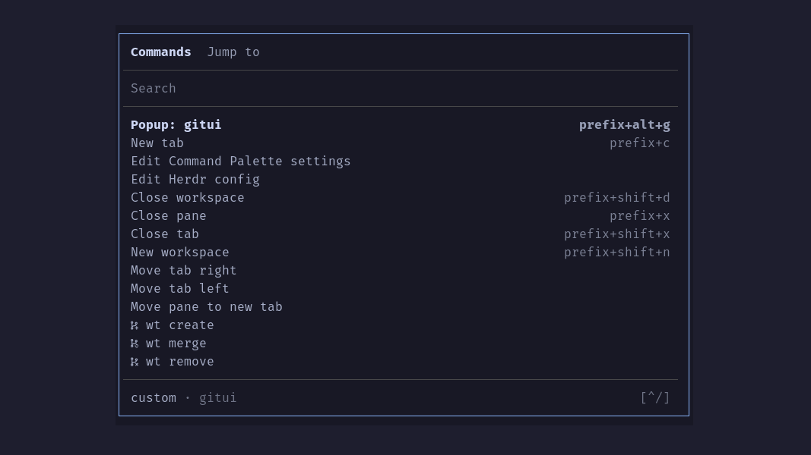

# herdr-command-palette

A minimal but fully featured fzf command palette for
[Herdr](https://herdr.dev). Run built-in, plugin and custom actions, and
jump quickly to agents and panes.



## Features

- **Run** built-in actions, plugin actions and custom commands, with available
  shortcuts shown beside them.
- **Jump** quickly to any pane and agent in any of your workspaces.
- **Find** what you used last on top, commands and panes alike.
- **Repeat** your last command or jump with a shortcut, without
  opening the palette.
- **Fit** any terminal size, with a compact layout for narrow windows.
- **Match** your Herdr theme, in light and dark.
- **Configure** it to match your preferences and colors.

## Requirements

- [Herdr](https://herdr.dev/) 0.9.3 or later
- [fzf](https://github.com/junegunn/fzf#installation) 0.66 or later on Herdr's `PATH`
- Linux or macOS

**Optional:**

- git 2.22 or later on Herdr's `PATH` (to show git information)

## Install

```sh
herdr plugin install mcavallo/herdr-command-palette
```

To learn more about installing and verifying releases, see
[docs/installing.md](docs/installing.md).

## Open the palette

Bind the palette's `open` action in Herdr's `config.toml`:

```toml
[[keys.command]]
key = "prefix+space"
type = "plugin_action"
command = "mmc.command-palette.open"
description = "Open command palette"
```

## Categories

The palette has two lists:

- **Commands:** Herdr's built-in actions, actions from your installed
  plugins, your custom commands (`[[keys.command]]` in Herdr's
  `config.toml`) and the palette's own commands. Each entry shows its
  shortcut when available.
- **Jump to:** panes across all workspaces, with the running agent shown
  when present.

> Press `tab` or `shift-tab` to switch categories.

## Search

Type to filter the list. Matching is fuzzy, and fzf's
[search syntax](https://junegunn.github.io/fzf/search-syntax/) is also supported:

- `'word` for an exact match
- `^word` and `word$` to match the start or end of a term
- `!word` to exclude a term
- `a | b` to match either term

Shortcuts, workspace names, agent names and pane names match as well.
Once you type, the best matches come first.

## Recent first

The palette remembers, per Herdr session, which commands you ran and
which panes you visited:

- **Commands** shows recently run commands first, followed by the fixed
  command order.
- **Jump to** shows recently visited panes first, followed by Herdr's
  order. The current pane appears last.
- Search results are ranked by match quality.

Use `skip_recent_ids` to keep commands in their fixed positions. By
default, this applies to Reload config.

History entries expire after 90 days by default (`max_age_days`).

> Set `enabled = false` in `[history]` to disable history and repeat actions.

## Repeat commands and jumps

Two actions are available for key bindings:

| Action                               | Does                                                               |
| ------------------------------------ | ------------------------------------------------------------------ |
| `mmc.command-palette.repeat-command` | Run the last command again                                         |
| `mmc.command-palette.repeat-jump`    | Jump to the last pane you jumped to, other than the one you are in |

Bind them in Herdr's `config.toml`:

```toml
[[keys.command]]
key = "prefix+."
type = "plugin_action"
command = "mmc.command-palette.repeat-command"
description = "Repeat last command"

[[keys.command]]
key = "prefix+,"
type = "plugin_action"
command = "mmc.command-palette.repeat-jump"
description = "Repeat last jump"
```

Repeat jump skips the current pane. Repeated use switches between the
last two panes you selected through the palette.

## Settings

All settings are optional. Run **Edit Command Palette settings** to
create `settings.toml` in the plugin's configuration directory
(`herdr plugin config-dir mmc.command-palette`) and open it in your
editor.

For every setting and its default, see
[docs/settings.md](docs/settings.md).

## Palette commands

The plugin adds these commands to the Commands list:

| Command                       | Does                                                                                                                                                            |
| ----------------------------- | --------------------------------------------------------------------------------------------------------------------------------------------------------------- |
| Move pane to new tab          | Moves the focused pane into a new tab in the same workspace                                                                                                     |
| Move pane to new workspace    | Moves the focused pane into a new workspace                                                                                                                     |
| Edit Herdr config             | Opens Herdr's `config.toml` in your editor in a popup, then checks and reloads it                                                                               |
| Edit Command Palette settings | Opens the palette's `settings.toml` in your editor in a popup (creating it first if needed), then checks it ([more](docs/settings.md#create-the-settings-file)) |

## Known limits

- Herdr renders plugin popups, including the palette and its confirmation
  dialog, within the main pane area, excluding the sidebar. With the
  sidebar open, they are centered differently from Herdr's native dialogs.
- Herdr popups reserve two extra columns on the right-hand side. There is
  currently no way to remove this space, so popup content cannot extend
  edge to edge.
- With `herdr --remote`, the palette uses the server's theme, not the
  client's.
- Changes to the terminal's light or dark appearance take effect when
  the palette next opens.

## Contributing

See [CONTRIBUTING.md](CONTRIBUTING.md).

## License

Copyright (C) 2026 Mariano Cavallo.

This program is free software: you can redistribute it and/or modify it under
the terms of the GNU General Public License as published by the Free Software
Foundation, either version 3 of the License, or (at your option) any later
version. See [LICENSE](./LICENSE) for the full text.
