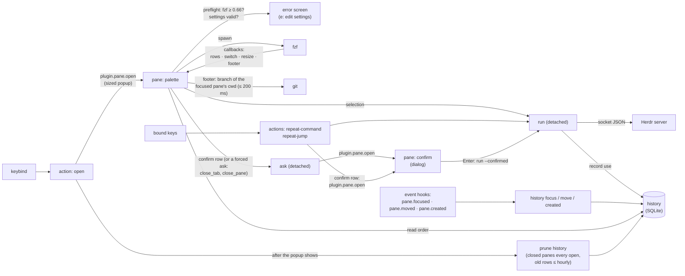
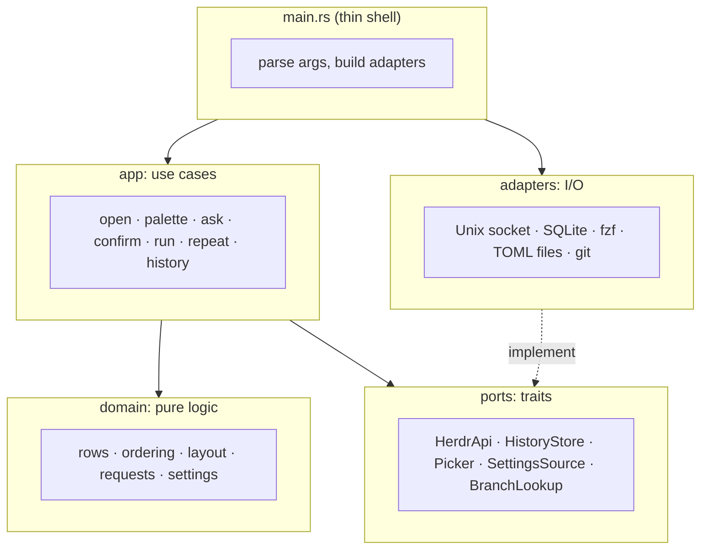
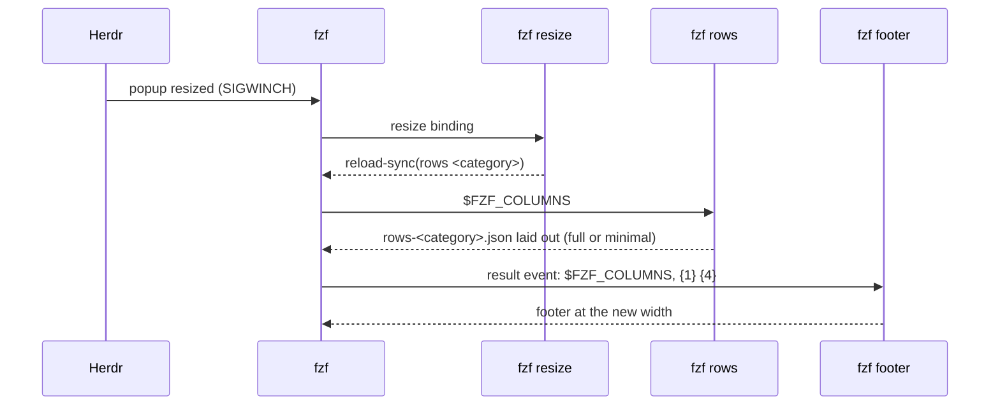
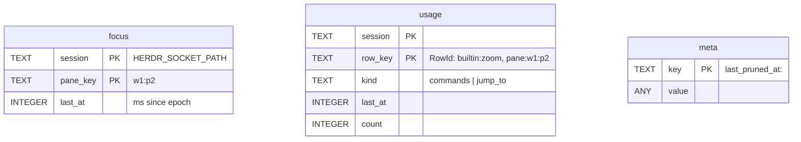

# Architecture

The command palette runs as a Herdr plugin. It builds searchable command
and pane lists from Herdr, displays them with fzf, and executes selections
through Herdr's socket API or a shell command. SQLite stores command usage
and pane focus history for recent ordering and repeat actions.

## Process model

One binary, `herdr-command-palette`, with one subcommand per role. Herdr
starts it from the plugin manifest (`herdr-plugin.toml`); fzf calls back
into it while the popup is open.



| Subcommand                           | Started by                                                                 | Does                                                                                                                                                                    |
| ------------------------------------ | -------------------------------------------------------------------------- | ----------------------------------------------------------------------------------------------------------------------------------------------------------------------- |
| `open`                               | `[[actions]] open`                                                         | Snapshot, size the popup, `plugin.pane.open`, then prune history (closed panes every time, old rows at most hourly; nothing when the snapshot has no panes)             |
| `palette`                            | `[[panes]] palette`                                                        | Check fzf, build rows, run fzf, dispatch the selection                                                                                                                  |
| `fzf rows\|switch\|resize\|footer`   | fzf bindings (run under `sh -c` with the binary named as `"$HCP_PROGRAM"`) | Category reload (rows laid out for `$FZF_COLUMNS`), header, re-layout on resize, footer; Jump to's footer asks git for the focused pane's branch (hidden from `--help`) |
| `run [--confirmed] <kind> <payload>` | palette, repeat actions, `confirm` pane (`--confirmed`, hidden)            | Execute a row, record it; a confirmed `close_tab` / `close_pane` that Herdr would refuse (worktree group) closes the group                                              |
| `ask <kind> <payload> <title>`       | palette (detached)                                                         | Open the `confirm` popup for a `confirm_ids` row once the palette's popup has closed (hidden from `--help`)                                                             |
| `exec`                               | `[[panes]] exec`                                                           | Run a custom popup/pane command, keep failures on screen                                                                                                                |
| `repeat-command`, `repeat-jump`      | `[[actions]]`                                                              | Rerun the newest history entry of that kind that still exists                                                                                                           |
| `confirm`                            | `[[panes]] confirm`                                                        | Herdr's close dialog for a `confirm_ids` row (palette or repeat), Enter runs it (hidden from `--help`)                                                                  |
| `history focus`                      | `[[events]] pane.focused`                                                  | Record one focus, exit fast                                                                                                                                             |
| `history move`                       | `[[events]] pane.moved`                                                    | Carry a pane's history to its new id                                                                                                                                    |
| `history created`                    | `[[events]] pane.created`                                                  | Drop an earlier pane's history under the new pane's (reused) id                                                                                                         |
| `list [--ids]`                       | developers                                                                 | Print rows (debugging); `--ids` for the settings                                                                                                                        |
| `settings check [--file <path>]`     | Edit settings row (with the edited path), users                            | Validate `settings.toml` (or `--file`), exit 1 with the problem                                                                                                         |

## Confirmation dialog

Rows listed in `confirm_ids` require confirmation. Palette selections and
repeat actions use the same `confirm` popup, which follows Herdr's close
dialog and measures 64 columns by 7 rows, or 6 rows without detail.
Herdr shows one popup at a time, so the palette passes the selected row
to a detached `ask` process and exits before opening confirmation.

When Herdr's `[ui] confirm_close` is enabled, `dialog::is_required` also
requires confirmation for `close_tab` on a workspace's last tab and for
`close_tab` or `close_pane` that would close a worktree group. For group
closures, confirmed `run` sends `workspace.close {close_group: true}`
through `requests::group_closed_by` and `confirmed_builtin_effect`.

```mermaid
sequenceDiagram
  participant P as palette (popup)
  participant A as ask (detached)
  participant H as Herdr
  participant C as confirm (popup)
  participant R as run (detached)
  P->>A: spawn ask -- kind payload title
  P-->>H: exit (popup closes)
  A->>H: session.snapshot (popup size)
  A->>H: plugin.pane.open confirm 64×7 or 64×6 (ui_busy retried 40×50 ms)
  H->>C: start, HCP_CONFIRM={kind, payload, title} (JSON)
  C->>H: session.snapshot (detail lines, best effort)
  C->>C: draw dialog, read one key
  C->>R: Enter: spawn run --confirmed -- kind payload
  C-->>H: exit (popup closes; can't spawn: notification, exit 1)
  R->>H: the row's request (ui_busy retried)
```

Repeat actions call `open_confirm` directly because they have no popup
to close first.

## Layers

The project uses ports and adapters (hexagonal architecture). Domain
logic has no dependency on sockets, files or fzf. Use cases access these
resources through traits called ports, and adapters implement the traits.
Tests replace adapters with in-memory fakes to exercise use cases without
external processes or files.



| Module                           | Responsibility                                                                                                                                                                                                      |
| -------------------------------- | ------------------------------------------------------------------------------------------------------------------------------------------------------------------------------------------------------------------- |
| [`cli`](../src/cli.rs)           | Declares subcommands and arguments with clap. Parses row kinds, categories and footer events at the CLI boundary.                                                                                                   |
| [`app`](../src/app.rs)           | Dispatches subcommands. `Context` supplies the environment and port implementations; `retry_policy` controls retries for each role.                                                                                 |
| `app/open`                       | Gets a snapshot, sizes the popup within the target tab's layout area and `[popup]` bounds, and opens `palette`. Reports failures through notifications. Prunes history after opening, when settings are valid.      |
| `app/palette`                    | Checks fzf and settings, builds and saves rows, starts fzf on `open_on`, and dispatches the selection to detached `run` or `ask`. Displays preflight failures in the popup; `e` opens invalid settings for editing. |
| `app/fzf_callbacks`              | Reloads rows, updates the header and footer, and handles category changes and resize events. Looks up the focused pane's git branch through `BranchLookup`.                                                         |
| `app/run_row`                    | Maps a row to an `Effect`: a Herdr request, detached shell command, or no action. Records usage and reports failures to stderr and notifications. `HCP_DRY_RUN=1` prints the effect.                                |
| `app/settings`                   | Validates the selected settings file for `settings check`.                                                                                                                                                          |
| `app/exec`                       | Runs `sh -c "$HCP_EXEC"` and keeps failures visible until a key press.                                                                                                                                              |
| `app/list`                       | Prints rows as TSV, or row IDs and titles with `--ids`.                                                                                                                                                             |
| `app/history`                    | Handles focus, move and creation hooks with one store operation. Hooks are silent on success, always exit 0 and do nothing when history is disabled.                                                                |
| `app/recent`                     | Reads focus and usage order for the palette. Falls back to fixed ordering when history is unavailable.                                                                                                              |
| `app/repeat`                     | Finds the newest existing, visible row, excluding the current pane. Opens confirmation when required and reports unavailable history or rows through notifications.                                                 |
| `app/ask`                        | Opens the confirmation popup through `open_confirm`, shared with repeat actions. Clamps its size to the target tab and retries `ui_busy`.                                                                           |
| `app/confirm`                    | Draws the dialog using a best-effort snapshot and Herdr's theme. Enter starts detached `run --confirmed`; other keys close it. A spawn failure triggers a notification and exit status 1.                           |
| [`domain`](../src/domain.rs)     | Defines shared types and pure logic for catalog construction, layout, requests, settings, history and themes.                                                                                                       |
| [`ports`](../src/ports.rs)       | Defines `HerdrApi`, `ConfigSource`, `SettingsSource`, `Picker`, `Spawner`, `Terminal`, `Files`, `Clock`, `HistoryStore` and `BranchLookup`.                                                                         |
| [`adapters`](../src/adapters.rs) | Implements ports with Unix sockets, TOML files, fzf, processes, terminal operations, private temporary directories, the system clock, SQLite and git.                                                               |

### Domain modules

`row`, `herdr`, `config` and `env` define shared data, request and response
shapes, and resolved environment values. `commands` defines `Builtin` and
`PaletteCommand`, shared by `catalog` and `requests`; catalog construction
does not depend on request mapping. `BUILTINS` and `PALETTE_COMMANDS` are
the central tables of names, display text and actions. `jump_to` builds
pane rows, and `requests` maps rows to effects matching Herdr's keybinds.

`layout` computes terminal widths, truncation, row rendering, headers,
footers and dialog lines. Rows use four TSV fields: kind, payload, display
text and tagged footer text. Display fields are cleaned of control
characters and reserved tags; payloads are cleaned of control characters
only. `tags` defines the `{hcp:<name>}` grammar and serializes and parses
footer lines. Commands use one footer line; Jump to uses two. The last
line includes the `[^/]` hint. In description mode, Jump to shows the git
branch before the working directory, with the branch limited to 30% of
the available width. The git adapter limits each lookup to 200 ms;
`domain::git` defines the commands and parses their output into `Head`.

`style` combines settings' `[colors]` overrides with Herdr's theme and
produces fzf colors and terminal escapes, which `color` renders. Tag
labels default to the theme's `subtext0`, and branches default to
`mauve`. `theme` resolves
Herdr's theme, including `auto_switch`; `appearance` interprets the
terminal's light or dark response. `dialog` defines the confirmation
text to match Herdr's close dialog. `popup` computes popup bounds and
accounts for Herdr's frame width through `outer_width`.

`settings` parses typed settings with defaults, rejects unknown keys,
reports the key and line for invalid values, and provides the commented
default file. `history` defines session and usage keys, custom-command
hashes, epoch-millisecond timestamps and pruning intervals. `recent`
orders commands and panes. `retry` defines retry policies, `shell` quotes
shell arguments, and `fzf_action` chooses a delimiter that can safely
contain an fzf action's argument.

### Theme resolution

With Herdr's `auto_switch` enabled, the palette and confirmation popup
query terminal appearance once before drawing. An explicit light or dark
report takes precedence over the reported background color; an absent
answer defaults to dark. Theme resolution selects `dark_name` or
`light_name`, applies shared custom colors, then applies the selected
mode's overrides. Unknown theme names fall back to catppuccin, or
catppuccin-latte for the light mode. Without `auto_switch`, terminal
appearance is ignored.

fzf callbacks use the appearance passed by the palette because fzf owns
the terminal while they run. The appearance remains fixed for that popup.
The plugin reads the server's Herdr configuration, so a remote client with
different local theme settings can display different colors.

### Callback state and process lifecycle

Each palette saves its rows once as JSON in a private temporary directory.
The callbacks format these rows for `$FZF_COLUMNS`, with the saved
formatted rows as a fallback. The palette passes `HCP_STATE`,
`HCP_PROGRAM` and, when available, `HCP_APPEARANCE` to fzf. The
`--with-shell=sh -c` option runs bindings under POSIX sh. Bindings quote
`"$HCP_PROGRAM"` so binary paths are expanded by the shell rather than
interpreted as fzf placeholders or action delimiters.

The palette removes its state directory on normal exit. After creating
a new directory, it sweeps sibling `herdr-command-palette-<pid>-<n>`
directories last modified at least 24 hours ago, including leftovers from
terminated palettes. The sweep only considers real directories owned by
the same user, never follows symlinks, and ignores cleanup failures.
`palette_state` defines the naming and age rules; the `Files` port performs
the filesystem operations.

Selected actions run in detached processes so the palette can close before
an action opens another popup. `run`, `ask` and repeat actions retry
Herdr's `ui_busy` responses up to 40 times at 50 ms intervals. `open`
uses 10 attempts at the same interval to tolerate a closing popup without
waiting as long for one that remains open. Other roles do not retry.
Each request also has a 5 s limit to be sent and answered: a Herdr that
stops answering fails the request instead of hanging the process.

The detached `run` and `ask` processes write their output, which is
only errors, to `run.log` in the plugin's state directory (else
`$TMPDIR`, else `/tmp`). The file is appended to and never rotated: it
grows by a line or two per failure.

## Resize

Herdr resizes the popup with its terminal (polled every 100 ms, never
past the size it was opened with). fzf receives SIGWINCH and fires `resize`:



The layout mode comes from the width: minimal when the popup's outer
width (fzf columns + 3, Herdr's frame) is under 75% of `[popup]
min_width`. The palette's first frame uses the same rule with the
terminal's width. `reload-sync` swaps the list only when the new rows
are ready. The query stays; fzf keeps the cursor's position, and
`--tiebreak=index` keeps equal matches in list order at every width, so
that position is still the same row.

## Settings

`settings.toml` lives in Herdr's plugin configuration directory. Each
process reads it through `SettingsSource` when needed; settings are not
cached between invocations. A missing file uses defaults. Invalid settings
are handled according to the process role:

| Role             | Uses                                                                                         | Invalid settings                                     |
| ---------------- | -------------------------------------------------------------------------------------------- | ---------------------------------------------------- |
| `palette`        | hidden rows, orders, `open_on`, `confirm_ids`, `[colors]`, `[popup] min_width` (layout mode) | error screen: problem, key, line, file; `e` edits it |
| `open`           | `[popup]`, `[history]` (pruning)                                                             | defaults, silently (the palette shows it)            |
| `fzf` callbacks  | `muted`, `tags`, `branch`, `[popup] min_width` (layout mode)                                 | defaults, silently                                   |
| `run`            | `editor` (edit rows), `[history] enabled`                                                    | defaults, stderr + one toast (not for Edit settings) |
| repeat actions   | `[history] enabled`, `confirm_ids`                                                           | defaults, stderr + one toast                         |
| `ask`            | nothing                                                                                      | n/a                                                  |
| `confirm` pane   | nothing (Herdr's theme only)                                                                 | n/a                                                  |
| hooks            | `[history] enabled`                                                                          | defaults, silently                                   |
| `settings check` | everything                                                                                   | exit 1 with the problem                              |

"Edit Command Palette settings" writes the commented default file
(`settings::template`) when there is none, then opens
`<editor> <file> && <binary> settings check --file <file>` in the `exec`
popup (`--file`: the check reads the file just edited, not whatever the
pane's environment names).

## History store

SQLite (bundled), one small database in the plugin's state directory.
Written by many short-lived processes at once (one per pane focus), so it
uses write-ahead logging (WAL) with no checkpoint on close and a 250 ms
busy timeout.

```mermaid
sequenceDiagram
  participant H as Herdr
  participant F as history focus
  participant O as open (action)
  participant P as palette
  participant S as store (SQLite)
  H->>F: pane.focused
  F->>S: upsert focus (session, pane, now)
  F-->>H: exit 0
  H->>O: prefix+space
  O->>H: plugin.pane.open (popup appears)
  O->>S: prune closed panes (every open; old rows ≤ once/hour; skip if busy)
  P->>S: read recent order
  P->>H: session.snapshot
  P->>P: ignore closed panes, order rows
```

Rows are keyed by Herdr's socket path (identifies the session across
restarts) plus the pane id (survives restarts; changes only when a pane
moves to another workspace, which `history move` handles). Workspace
numbers aren't persisted: after a restart a closed newest workspace's
number, and so its pane ids, can come back. `history created` (hook
`pane.created`) deletes the new pane's rows older than 2 s, so a reused
id starts without history while the new pane's own first focus stays;
every `open` also prunes closed panes, except when the snapshot has no
panes.



Schema version in `PRAGMA user_version` (1). The first process to open
a new file sets it up under a file lock (`history.db.lock`); every later
open is one read. `HistoryStore` methods:

| Method                                     | For                                                                                                                                |
| ------------------------------------------ | ---------------------------------------------------------------------------------------------------------------------------------- |
| `record_focus(session, pane, at)`          | `history focus`                                                                                                                    |
| `rename_pane(session, from, to)`           | `history move`: focus row and `pane:` usage row, one transaction                                                                   |
| `forget_pane(session, pane, before)`       | `history created`: focus row and `pane:` usage row older than `before`, one transaction                                            |
| `record_usage(session, row_id, at)`        | `run` (count + 1, kind from the row's category; custom commands keyed `custom:<hash of type + command>`)                           |
| `focus_order(session)`                     | Jump to "recent" order (pane ids, newest first)                                                                                    |
| `usage_order(session, category)`           | Commands "recent" order (row ids, newest first)                                                                                    |
| `prune(session, live_panes, max_age, now)` | `open`, after the popup shows, at most hourly: closed panes, rows past `max_age`, last prune time; 20 ms wait, `Skipped` when busy |
| `prune_closed(session, live_panes)`        | `open`, after the popup shows, when `prune` isn't due: closed panes only; 20 ms wait, `Skipped` when busy                          |
| `last_pruned_at(session)`                  | `open`: prunes at most hourly per session (`domain::history::is_prune_due`)                                                        |

Store reads return persisted rows; callers filter them against the live
snapshot.

The palette puts recently run commands first (then the fixed order) and
recently focused panes first (then Herdr's order, the current pane last);
the repeat actions take the newest row still in a fresh catalog and
visible (not hidden, not the current pane). With
`[history] enabled = false` nothing is read or written: fixed orders,
repeat actions say "history is off".
