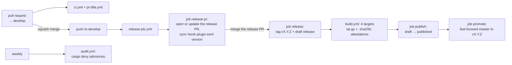

# Releasing

How a change becomes a release that Herdr users install. For checks on
pull requests, see [development.md](development.md#github-actions).

## Branches

| Branch    | Role                                        | Written by                              | Read by                                          |
| --------- | ------------------------------------------- | --------------------------------------- | ------------------------------------------------ |
| `develop` | Work branch: pull requests merge here       | You, squash merges of pull requests     | CI, release-plz                                  |
| `master`  | Stable: always the latest published release | The release App only, fast-forward only | Herdr marketplace, `herdr plugin install/update` |

`master` is the GitHub default branch, because Herdr's marketplace and
`herdr plugin install` read the default branch. Open pull requests
against `develop` (`gh pr create --base develop`). GitHub suggests
`master`: `pr-base.yml` moves such a pull request (from a branch of this
repository; it skips forks) to `develop` within seconds, comments, and closes and reopens it with the release App's
token so CI runs (only against `develop`). The `master` ruleset would
also refuse the merge.

## How it works



| Workflow          | Runs on                                              | Does                                                                                                       |
| ----------------- | ---------------------------------------------------- | ---------------------------------------------------------------------------------------------------------- |
| `ci.yml`          | pull requests against `develop`, pushes to `develop` | The checks of `mise run ci`: lint, deny, coverage (Linux), tests (macOS), MSRV                             |
| `pr-title.yml`    | pull requests                                        | PR title follows Conventional Commits                                                                      |
| `pr-base.yml`     | pull requests against `master`                       | Moves them to `develop`                                                                                    |
| `release-plz.yml` | pushes to `develop`                                  | Opens or updates the release PR; after a release PR merge, tags, builds, publishes, then promotes `master` |
| `build.yml`       | called by `release-plz.yml`, manual                  | Builds the release binaries; with a tag, uploads them to the release and attests them; without, a dry run  |
| `audit.yml`       | weekly, manual                                       | `cargo deny check advisories`, so a new advisory shows up between changes                                  |

CI doesn't run on `master`: `promote` only moves it to a commit that
was already checked on `develop`.

### Versions and the changelog

[release-plz](https://release-plz.dev) reads the Conventional Commit
messages on `develop` since the last `vX.Y.Z` tag and proposes the next
version: `fix:` bumps the patch, `feat:` the patch while in `0.x` (the
minor from `1.0`), a `!` breaking change the minor in `0.x` (the major
from `1.0`). Merges are squashed with the PR title as the commit
message, so **the PR title is the changelog entry**.

Settings are in `release-plz.toml`: versions come from git tags
(`git_only`, nothing goes to crates.io), a release only happens when a
release PR is merged (`release_always = false`), the release starts
as a draft, and only user-facing commits open a release PR
(`release_commits`): `feat:`, `fix:`, `perf:`, or any type marked
breaking with `!`. `ci:`, `docs:`, `chore:`, `test:`, `refactor:` alone
don't; they still appear in the next release's changelog.

### Why the manifest version is synced

Herdr's [marketplace](https://herdr.dev/docs/marketplace/) reads
`version`, `platforms` and `min_herdr_version` from `herdr-plugin.toml`
on the default branch. release-plz only bumps `Cargo.toml` and
`Cargo.lock`, so the `release-pr` job runs `scripts/sync-version.sh` on
the release PR branch and commits the manifest. CI fails any PR where
the two versions differ (`scripts/sync-version.sh --check`).

### Why `master` is promoted last

`master` moves only after the release is published, so whatever Herdr
users install always has its binaries online. If a build fails, the
release stays a draft and `master` stays on the previous release: users
see nothing of it.

`promote` pushes the tag's commit to `master` without `--force`, so the
push only succeeds as a fast-forward. Since the release commit is on
`develop` and `master` only ever holds earlier release commits, that is
always the case unless someone wrote to `master` some other way.

### Why a GitHub App token

Pushes, pull requests and tags made with the workflow's own
`GITHUB_TOKEN` don't start other workflows, and rulesets can't exempt
it. The release App's token covers both: CI runs on the release PR
(required checks), and the App is the only actor allowed to update
`master` and create `v*` tags. Configured as the repository variable
`RELEASE_APP_CLIENT_ID` and the secret `RELEASE_APP_PRIVATE_KEY`.

### Release assets

One archive per target, plus a checksum file:

| Target                       | Built on                      |
| ---------------------------- | ----------------------------- |
| `aarch64-apple-darwin`       | macOS runner                  |
| `x86_64-apple-darwin`        | macOS runner (cross-compiled) |
| `x86_64-unknown-linux-musl`  | Linux runner (static)         |
| `aarch64-unknown-linux-musl` | Linux runner (cross, static)  |

Names: `herdr-command-palette-<target>.tar.gz` (the binary at the
archive root) and `herdr-command-palette-<target>.tar.gz.sha256`. Before
upload, each binary except `x86_64-apple-darwin` (cross-compiled on an
arm64 runner) is started with `--version`, `aarch64` Linux under QEMU.

Each archive gets a build provenance attestation (Sigstore, signed with
the workflow's GitHub identity, no key to manage). Attestations need a
public repository; on a private one (a fork, say) the step is skipped.

### How users get the binary

`herdr plugin install mcavallo/herdr-command-palette` clones `master`
and runs the manifest's `[[build]]` command, `scripts/install.sh`:

1. Reads the version from `Cargo.toml` and the target from `uname`.
2. Downloads `vX.Y.Z`'s archive and `.sha256` (no retries: any
   failure falls back to step 3), checks the checksum, puts the binary
   at `target/release/herdr-command-palette`.
3. On an unknown platform, a failed download or a checksum mismatch:
   `cargo build --release --locked` (needs Rust, at least the
   `rust-version` in `Cargo.toml`).
4. No cargo either: an error, and the install stops.

`master` is always exactly a release, so step 2 finds its binaries.
`herdr plugin update` fetches `master` again, so users get a new
release only once it is promoted.

The user-facing version, with the script's requirements and how to
verify a release, is in [installing.md](installing.md).

## Cutting a release

1. Merge pull requests into `develop` with Conventional Commit titles
   as usual. After each merge, the `release-pr` job opens or updates a
   pull request into `develop` titled `chore: release vX.Y.Z` (label
   `release`) with the version bump, `CHANGELOG.md` and the synced
   manifest.
2. When you want to release, open that pull request and review:
   - **Version:** to use a different one, check out the branch, set
     `version` in `Cargo.toml`, run `cargo update --workspace` and
     `mise run sync-version`, fix the heading in `CHANGELOG.md`, commit and
     push.
   - **`CHANGELOG.md`:** edit wording if needed.

   Make edits right before merging: release-plz regenerates the pull
   request when something else lands on `develop`.
3. Wait for CI to pass, then squash merge.
4. Watch the `release-plz` run on the merge commit (Actions tab, or
   `gh run watch`): `release` → `build` (4 jobs) → `publish` →
   `promote`.
5. [Verify](#verify-a-release).

### Dry run

To check the release build without releasing (after changing
`build.yml`, `Cargo.toml` profiles or dependencies with C code):
Actions → **build** → **Run workflow** on a branch, or

```sh
gh workflow run build.yml --ref <branch>
```

It runs the branch's version of `build.yml`, but GitHub only offers
manual runs for workflows that also exist on the default branch
(`master`). It builds the four targets and attaches the archives to the run as
artifacts (`gh run download <run-id>`); nothing is uploaded to a
release or attested.

### Retry a failed release

When a draft can't be fixed by re-running jobs (the fix is a code
change), the version on `develop` is already bumped but has no tag.
release-plz then opens no release PR (it only updates the changelog
of a version it considers bumped), and merging the fix alone doesn't
release: a release needs a merged pull request from a `release-plz-*`
branch. Open that pull request by hand:

```sh
v=v0.1.1                                       # the failed version
gh release delete "$v" --yes --cleanup-tag      # repository admins may delete v* tags
# land the fix on develop with a fix: pull request, then:
git fetch origin
git switch -c "release-plz-$v-retry" origin/develop
# CHANGELOG.md: add the fix under the version's heading
git commit -am "chore: release $v"
git push -u origin "release-plz-$v-retry"
gh pr create --base develop --title "chore: release $v" --body "Retry of the failed $v draft."
```

Merge it when CI passes: `release` tags the version on that merge
commit, which has the fix, and the rest runs as usual. The version is
reused: only a draft existed, and immutable releases only lock
published ones.

## Verify a release

```sh
v=v0.2.0
repo=mcavallo/herdr-command-palette

# Published, not a draft, 8 assets
gh release view "$v" --repo "$repo"

# master is the release commit
test "$(gh api "repos/$repo/commits/master" --jq .sha)" = \
  "$(gh api "repos/$repo/commits/$v" --jq .sha)" && echo promoted

# Checksum and provenance of one archive
gh release download "$v" --repo "$repo" \
  --pattern 'herdr-command-palette-x86_64-unknown-linux-musl.tar.gz*'
sha256sum -c herdr-command-palette-x86_64-unknown-linux-musl.tar.gz.sha256
gh attestation verify herdr-command-palette-x86_64-unknown-linux-musl.tar.gz --repo "$repo" \
  --signer-workflow "$repo/.github/workflows/build.yml"
```

`--signer-workflow` names `build.yml` because it is a reusable workflow:
it signs the attestations, called by `release-plz.yml`.

Then, within about 30 minutes, the plugin's card on the
[marketplace](https://herdr.dev/plugins/) shows the new version.

To check the install itself: `mise run e2e-install` installs the plugin
from GitHub with a fresh Herdr in a container and fails unless the
release binary was downloaded
([development.md](development.md#end-to-end-install-check)).

## When something goes wrong

Until `promote` succeeds, users still get the previous release: nothing
below is urgent for them.

| Problem                                                    | Fix                                                                                                                                                                                                                                                         |
| ---------------------------------------------------------- | ----------------------------------------------------------------------------------------------------------------------------------------------------------------------------------------------------------------------------------------------------------- |
| A `build` target failed                                    | The release stays a draft, `master` doesn't move. Fix the cause if it's outside the code, then **Re-run failed jobs** on the run: uploads overwrite, and `publish` and `promote` run after.                                                                 |
| `publish` or `promote` failed                              | **Re-run failed jobs**.                                                                                                                                                                                                                                     |
| `promote` fails with "not a fast-forward"                  | `master` has a commit that isn't on `develop`; the ruleset should prevent this. Find out how it got there, bring the change into `develop` with a pull request, and release again.                                                                          |
| The draft can't be fixed with reruns (needs a code change) | See [Retry a failed release](#retry-a-failed-release).                                                                                                                                                                                                      |
| A published release is broken                              | Release a fixed patch version. Published releases can't be changed (immutable releases); don't delete them, users may have pinned them.                                                                                                                     |
| The release PR has no manifest sync commit, CI fails       | Re-run the `release-pr` job, or on the branch: `mise run sync-version`, commit, push.                                                                                                                                                                       |
| CI didn't start on the release PR                          | The App token isn't used or has lost access: check the `RELEASE_APP_CLIENT_ID` variable, the `RELEASE_APP_PRIVATE_KEY` secret and that the App is installed on the repository.                                                                              |
| No release PR appears                                      | No `feat:`, `fix:`, `perf:` or `!` commit since the last tag (`release_commits`), or the `release-pr` job failed.                                                                                                                                           |
| A pull request still targets `master`                      | `pr-base.yml` didn't run or failed: **Edit** next to the title, set the base to `develop`.                                                                                                                                                                  |
| `audit.yml` failed                                         | A dependency has a new advisory. Update it (`cargo update -p <crate>`) or, if it doesn't affect the plugin, ignore it in `deny.toml` with a reason. GitHub disables scheduled runs after 60 days without repository activity: re-enable in the Actions tab. |
